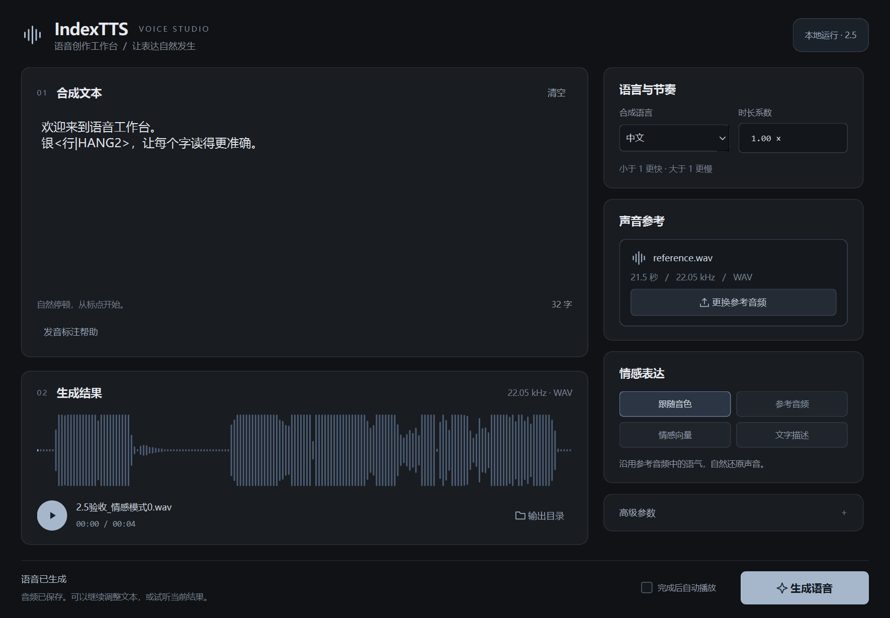

# IndexTTS For Windows

本项目从原桌面助手的 `file/extend/IndexTTS` 模块分离，保留原来的 PyQt6 语音合成窗口和 IndexTTS2 推理模型。模型、Python、运行依赖、缓存、日志和输出均放在本项目内，正常启动无需原桌面助手、全局 Conda 环境或联网下载。



## GitHub 源码与本地完整项目

GitHub 仓库发布当前独立桌面应用的源码、上游推理源码、依赖版本清单、界面截图、测试及合成验收样例。`even/` Python 环境、`models/` 模型文件、缓存和运行日志保留在本地，未放入 Git 提交。

因此，仅克隆 GitHub 仓库时还需要准备本项目内的 `even/` 和 `models/IndexTTS-2/`，随后才能启动；本机已经整理好的完整项目可以直接运行。

新机器可使用本机安装的 Conda，在项目目录创建所需的 Python 运行时并安装依赖：

```powershell
conda create --prefix ./even python=3.11 pip -y
.\even\python.exe -m pip install -r .\requirements.txt
```

模型文件应按 `model_manifest.json` 中的相对路径准备到 `models/IndexTTS-2/`，包括主模型、Qwen 情感模型、w2v-bert、MaskGCT semantic codec、campplus 和 BigVGAN 推理权重。之后运行 `.\run.bat --check` 检查环境及必要模型。

为继续遵守“根目录只有三个普通文件”的结构约定，Git 忽略规则保存在 `docs/gitignore`。新克隆后，在项目目录执行以下命令，避免后续提交环境、模型或个人输出：

```powershell
git config --local core.excludesFile docs/gitignore
```

## 启动

GitHub Release 的 `v1.2.0` 提供不含模型的轻量 Windows 程序包。首次双击 `run.bat` 会联网下载 Python 3.11 并将依赖安装到项目内 `even/`，无需提前安装 Python 或 Conda；中断后可再次运行重试。已配好 `even/` 的本机项目仍直接启动。

程序包和安装器不下载模型。模型放置路径见 `MODEL_SETUP.md`，本版详细说明见 `RELEASE_v1.2.0.md`。

双击项目根目录的 `run.bat`，或者在项目目录打开 PowerShell：

```powershell
.\run.bat
```

输入文本，选择音色参考音频，选择情感模式后点击“生成语音”。生成结果保存在 `outputs/`；可点击“打开输出目录”查看。默认完成后自动播放音频。

原有四种情感控制方式均保留：沿用音色参考音频的情感、使用情感参考音频、设置八维情感向量、输入文字情感描述。

## 工作台界面

界面采用炭黑、深灰与少量蓝灰色的平面配色。左侧为文本编辑和结果试听，右侧集中放置声音参考、情感表达及高级参数，底部固定显示状态与生成操作。

- 参考音频可点击选择，也可以直接拖入“声音参考”区域；选择后显示文件名、时长及采样率。
- 情感表达使用四个互斥按钮切换；情感向量以双列滑杆展示，支持鼠标拖动及键盘微调。
- 高级参数默认收起，点击后可编辑采样温度、Top P、Top K 与分段 Token 上限。
- 生成结果显示真实音频波形、文件名、时长和采样率；可播放、暂停，点击波形定位。
- “完成后自动播放”可关闭；生成完成直接更新结果区，不再弹出完成提示框。
- 右侧设置独立滚动，在较小窗口中展开设置后，底部生成操作仍保持可见。

Windows 实际窗口截图见 `desktop_window.png`、`desktop_result.png` 和 `desktop_emotion.png`。本轮界面验证记录见 `ui_verification.json`。

首次生成需要加载模型；后续任务复用同一个模型。生成时点击关闭，会在当前任务结束后自动关闭，避免工作线程被强制销毁。

## 目录

```text
IndexTTS/
├── run.bat                    # 双击入口，固定使用项目内 Python
├── start.py                   # 桌面应用入口及环境检查
├── requirements.txt           # 当前运行环境的完整版本锁定清单
├── app/                       # 独立窗口、推理封装、工作线程、路径管理
├── even/                      # 独立 CPython 3.11 运行时及依赖
├── vendor/                    # 复制的 IndexTTS 源码及原许可证
├── models/IndexTTS-2/          # 主模型、情感模型及必要辅助权重
├── outputs/                   # 生成音频，包括本次四种模式的验收样例
├── cache/                     # 项目内缓存与临时目录
├── logs/                      # 应用日志和验证日志
├── test/                      # test_ 开头的回归、真实合成与完整性检查脚本
├── tools/                     # 可选的依赖迁移辅助工具
└── docs/                      # 使用说明、待办、验证结果和迁移记录
```

项目根目录的普通文件严格限制为 `run.bat`、`start.py`、`requirements.txt`。

## 环境与模型

本次环境从原助手实际使用的 Python 运行时中复制，按依赖元数据选择 IndexTTS 所需的包及其依赖闭包；未使用原助手的轻量 `.venv`，也不需要激活原来的 Conda 环境。

- Python：3.11.15，独立运行时在 `even/python.exe`。
- PyTorch / torchaudio：2.8.0+cu129。
- Transformers：4.52.1。
- PyQt6：6.11.0。
- 当前依赖闭包共 120 个发行包，`pip check` 通过。
- Qwen 文字情感分类固定使用 CPU；当前机器的语音合成使用 GPU，避免约 8 GB 显存被常驻分类模型挤占。
- 不使用 DeepSpeed、torch.compile 或需要现场编译的 BigVGAN CUDA 扩展；普通 PyTorch CUDA 运算仍然启用。
- 必要辅助模型均已复制，本项目默认按离线方式运行。

模型仅复制推理需要的资源，未复制原目录内未使用的训练优化器、其他任务权重及重复模型。源项目和源模型文件保持原样。所复制模型与源文件的 SHA-256 比对结果见 `model_manifest.json`。

原环境中未使用的命令启动器已清理；当前 `even/Scripts/` 中的运行依赖命令已使用项目内解释器重新生成。

## 检查与测试

以下命令均在项目根目录执行：

```powershell
# 检查本地解释器、核心依赖、CUDA 和 18 项必要模型文件
.\run.bat --check

# 窗口、相对路径、线程关闭、中文路径及结果回调回归测试
.\even\python.exe -X utf8 -I -B .\test\test_standalone.py

# 拖放、模式切换、任务成功/失败、真实波形、播放定位与滑杆交互
.\even\python.exe -X utf8 -I -B .\test\test_ui_workflow.py

# 按项目内清单重新校验全部复制模型的 SHA-256
.\even\python.exe -X utf8 -I -B .\test\test_model_integrity.py

# 使用随项目保留的参考音频，执行四种模式的真实离线合成
.\even\python.exe -X utf8 -I -B .\test\test_inference.py --all-modes
```

本次真实验收记录见 `inference_verification.json`，四段音频在 `outputs/独立项目验收_模式0.wav` 至 `outputs/独立项目验收_模式3.wav`。这组数据验证可执行性、模型复用和音频文件有效性。

当前 `even/` 已准备好，正常使用无需安装依赖。若后续自行修复依赖，可运行：

```powershell
.\even\python.exe -m pip install -r .\requirements.txt
```

清单默认使用清华 PyPI 镜像，CUDA 12.9 版 PyTorch 通过官方补充源提供。保留的 `vendor/LICENSE`、`vendor/LICENSE_ZH.txt`、`vendor/DISCLAIMER` 及模型目录内许可证属于原项目资料。

## 故障定位

启动或生成失败时先查看 `logs/indextts.log`。模型缺失提示会列出项目相对路径；请恢复对应文件。程序不会回退到原助手的模型目录或自动读取原助手的配置。

启动器已经采用 UTF-8 编码和 Windows CRLF 换行；编辑 `run.bat` 后应保留这两项设置。
