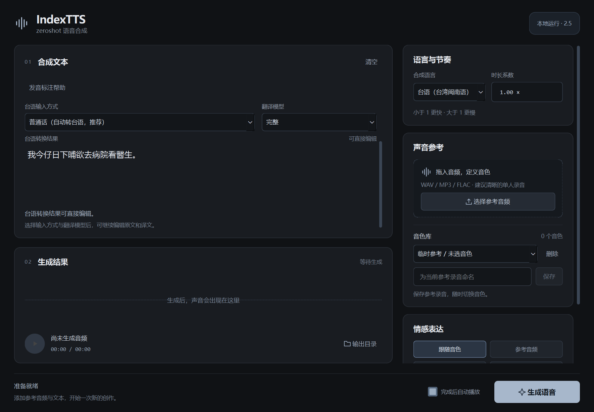

# IndexTTS For Windows

本项目是基于官方 **IndexTTS 2.5** 的 Windows 本地语音工作台，应用版本 **1.4.0**。支持中文、英文、日语、西班牙语、阿拉伯语，以及加载独立语言包后的台语（台湾闽南语）；使用一段参考录音克隆音色，支持四种情感模式、生成时的时长控制及发音标注。



## 启动

在项目目录双击 `run.bat`。首次运行自动下载 Python 3.11、安装依赖到项目内 `even/`；已存在的环境会按版本标记补齐新增依赖。普通依赖优先使用清华镜像，失败后尝试阿里云镜像；PyTorch CUDA wheel 使用官方补充源。无需全局 Python 或 Conda。

程序包不含模型。首次准备模型时，先完成运行环境安装，再按 `MODEL_SETUP.md` 下载权重到 `models/IndexTTS-2.5/`。程序运行时只读取项目内文件，缺失模型会显示具体路径，不会自动转用全局缓存。

```powershell
.\run.bat
# 检查核心模型；增加 --with-emotion 可同时检查文字情感模型。
.\run.bat --check --with-emotion
```

模型下载和首次环境安装需要联网；模型准备完成后的语音合成可离线运行。缺少模型时仍可打开界面查看说明，生成前会检查当前模式必需的文件。

## 使用

1. 输入文本，在“语言与节奏”中选择合成语言。
2. 拖入或选择音色参考音频，或在“音色库”下拉中选择已保存音色。
3. 按需要设置时长系数、情感和高级参数，点击“生成语音”。
4. 在结果区试听、点击波形定位，或打开 `outputs/` 查看 WAV 文件。

普通窗口下，台语输入方式与翻译模型按两列显示，各自的标签位于选择框上方。台语转换区或发音帮助展开后，可在左侧文本卡片内滚动查看原文、转换选项和译文；卡片标题、结果播放器和底部生成按钮保持可见。

时长系数为 `0.5–2.0`，`1.0` 为正常时长；小于 1 更快，大于 1 更慢。例如 `0.8` 约为原时长的 80%，`1.2` 约为原时长的 120%。这是模型生成过程的节奏控制，实际音频长度还受采样、停顿和分段影响。

发音控制直接写在合成文本中；点击“发音标注帮助”可查看示例：

```text
他在银<行|HANG2>工作。
He had a <minute|M IH1 . N AH0 T> to think.
彼は料理が<上手|じょうず>です。
```

四种情感模式包括：跟随音色参考、使用独立情感参考音频、八维情感向量、文字描述。文字情感模型只在首次使用该模式时加载到 CPU；其他模式无需该模型。空白情感描述表示从合成文本分析情感。

高级参数包括采样温度、Top P、Top K 和分段 Token 上限。8 GB 显存设备自动启用官方的长文本分段。发音标注会作为完整片段处理，英文音素中的句点不会截断标注；标注本身超过 Token 上限时会明确提示。

## 音色库

“声音参考”卡片内提供独立的“音色库”区域，沿用深色蓝灰样式。

1. 先拖入或选择参考录音，在名称框填写名称，点击“保存”。程序复制录音到项目内音色库，并立即应用。
2. 在下拉框选择已保存音色即可用于下一次合成，参考区显示音色名称、录音时长和采样率。重启程序会恢复上次选择。
3. 点击“删除”，确认后移除该条目及库内副本；“取消”保留条目。删除当前使用的音色时清空声音参考，须重新选择后再生成。

音色库位于 `models/voice_library/`：`library.json` 保存名称、相对路径、录音元数据、SHA-256 和上次选择，`audio/` 保存录音副本。原始录音不会被覆盖或删除，原录音移动后已保存音色仍可使用。同名音色会被拒绝，请换名另存；无法解码、全静音或超过 100 MB 的录音不能保存，M4A 等格式无法读取时请先转换为 WAV／FLAC。

这里的“音色”是 **IndexTTS 参考录音预设**，保存时不训练新模型。基础模型与台语 LoRA 继续由原语言设置控制；同一音色可用于各已支持语言，实际跨语言听感取决于模型。生成期间锁定库操作，避免正在使用的录音被本窗口删除；手动更换参考音频后自动切回临时参考状态。录音丢失或清单损坏会明确提示，清单损坏时保留原文件，仍可手动选择参考音频合成。

个人音色库随 `models/` 保持本地，不进入 Git 源码或不含模型的发行包。

## 台语与普通话输入

选择“台语（台湾闽南语）”，默认输入普通话。程序先查询词库中的明确对译，未命中
时调用项目内 Taigi-Llama-2 专用模型转换为台语，再由台语 LoRA 合成。下方“台语
转换结果”可以直接编辑，生成使用当前结果，不会再次把它当普通话翻译。
也可以切换“台语汉字”或“带声调台罗”，直接输入台语。翻译在后台线程中运行，
首轮需要加载模型和词库，完成后显示结果；原普通话输入会保留。

语言包放在 `models/extra_language/zh-nan-tw/`：`model/` 为正式适配器及语言行，
`words/` 为带来源的词库，`translation/taigi/` 为 7B Q4_K_M 翻译模型。台语语音仍
需要匹配的 `models/IndexTTS-2.5/` 基础权重。详见 `MINNAN_LANGUAGE_PACK.md`。

翻译模型限非商业用途，词库各来源许可不同；许可和原始文件摘要随语言包保存。
自动译文、专有名词及声调需要复核；词库没有收录整句时会使用翻译模型，不能把
THUOCL 普通话候选词当成已确认台语对译。

## 本地运行与质量处理

- 项目内 `even/python.exe` 为唯一运行解释器，缓存、临时文件和日志均在本项目内。
- CUDA 设备支持时使用 BF16；不支持时使用 FP32。不要求安装 DeepSpeed、FlashAttention 或现场编译 CUDA 扩展。
- 已加载的模型与未变化的参考条件重复使用；相同路径的录音被覆盖后，会重新提取参考条件。
- 声码器输出超限时先等比例降低增益，再转换 PCM，避免直接截幅带来的失真；保留官方尾部淡出处理。
- 结果先写入临时音频，确认可解码后才替换最终文件；生成失败不会损坏同名已有结果。
- 生成期间锁定声音设置，后台任务结束后恢复；关闭窗口时等待当前任务安全结束。
- 西班牙语数字等文本归一化沿用官方可选 NeMo 前端；Windows 默认依赖不含 NeMo，不可用时按官方逻辑保留原文，数字可写成相应语言文字。

## 目录与分发

```text
IndexTTS/
├── run.bat
├── start.py
├── requirements.txt
├── app/                       # 桌面工作台、推理与线程
├── even/                      # 项目内 Python 及依赖
├── vendor/                    # 官方 2.5 推理所需源码与许可证
├── models/IndexTTS-2.5/        # 2.5 主模型及辅助权重
├── models/extra_language/zh-nan-tw/ # 台语模型、词库及整句翻译
├── models/voice_library/       # 个人音色名称、录音副本与选择状态（首次保存创建）
├── outputs/                   # 生成音频
├── cache/                     # 缓存与临时文件
├── logs/                      # 运行和验收日志
├── test/                      # test_ 开头的测试脚本
├── tools/                     # 环境安装、模型下载及无模型打包
└── docs/                      # 使用说明、来源、待办与验收记录
```

根目录只有 `run.bat`、`start.py`、`requirements.txt` 三个普通文件。源码与轻量发行包不包含运行环境或模型。Git 忽略规则位于 `docs/gitignore`，克隆后执行：

```powershell
git config --local core.excludesFile docs/gitignore
```

## 验证与构建

以下命令均在项目根目录执行，使用真实宿主机的项目内环境：

```powershell
.\even\python.exe -X utf8 -I -B -m unittest discover -s .\test -p 'test_*.py' -v
.\even\python.exe -X utf8 -I -B .\test\test_inference.py --all-modes --multilingual --duration-check
.\even\python.exe -X utf8 -I -B .\test\test_model_integrity.py
.\even\python.exe -X utf8 -I -B .\test\test_desktop_launch.py
.\even\python.exe -X utf8 -I -B .\tools\build_release.py --lightweight
.\even\python.exe -X utf8 -I -B .\test\test_release_package.py --lightweight --extract-smoke
```

具体结果见 `upgrade_v25_verification.json`、`inference_verification.json`、`desktop_verification.json` 和构建目录的 `verification.json`。自动音频检查验证采样、时长和非静音等工程指标，不代替各语言母语听审。

官方来源与固定提交见 `upstream_v25.json`；本地模型的来源修订、大小和 SHA-256 见 `model_manifest.json`。第三方许可保留在 `vendor/` 和模型原始许可证中。
